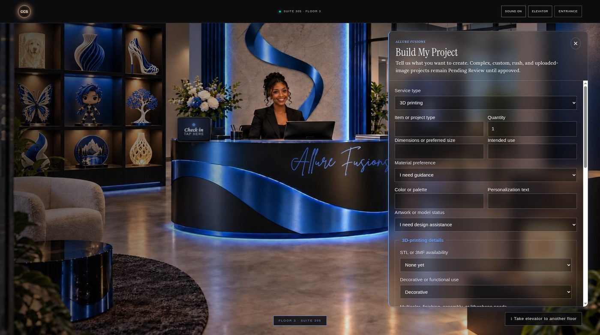
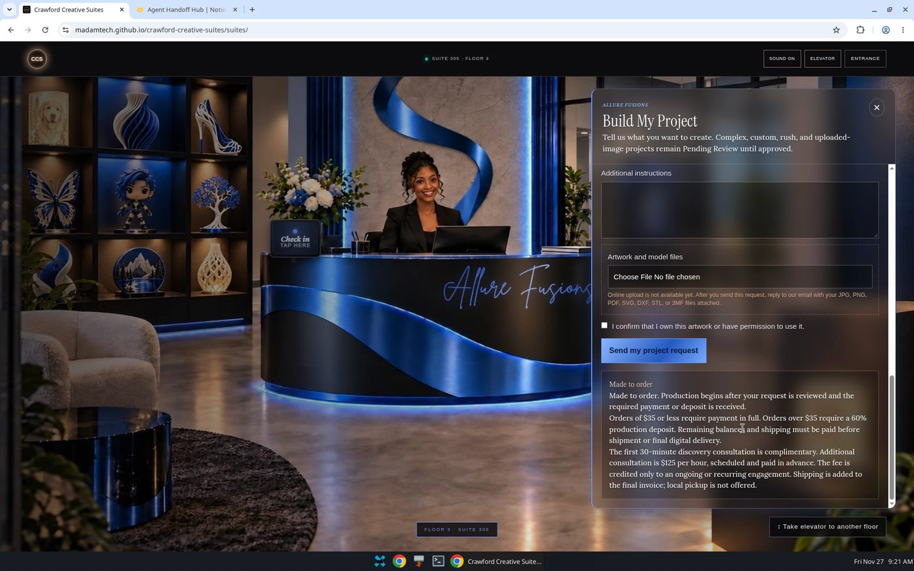
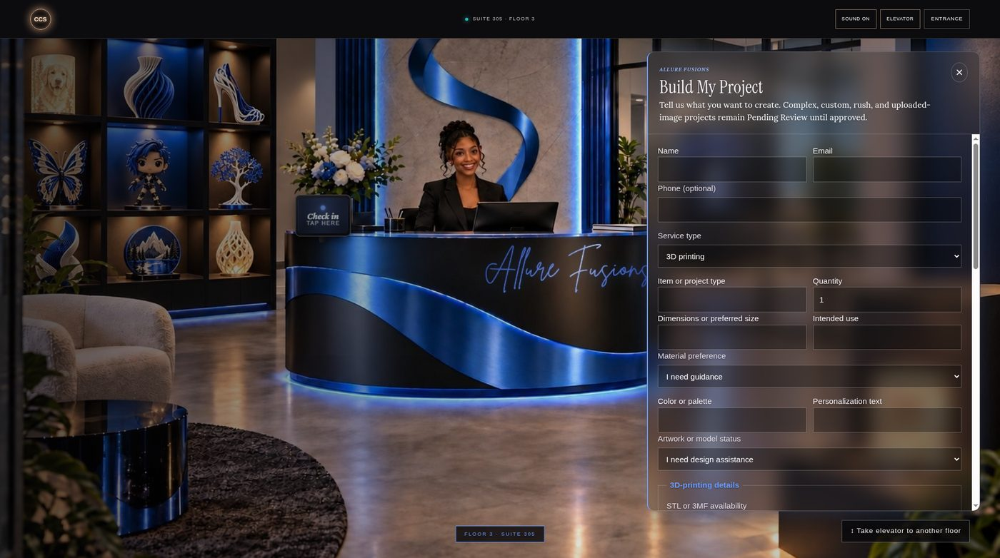
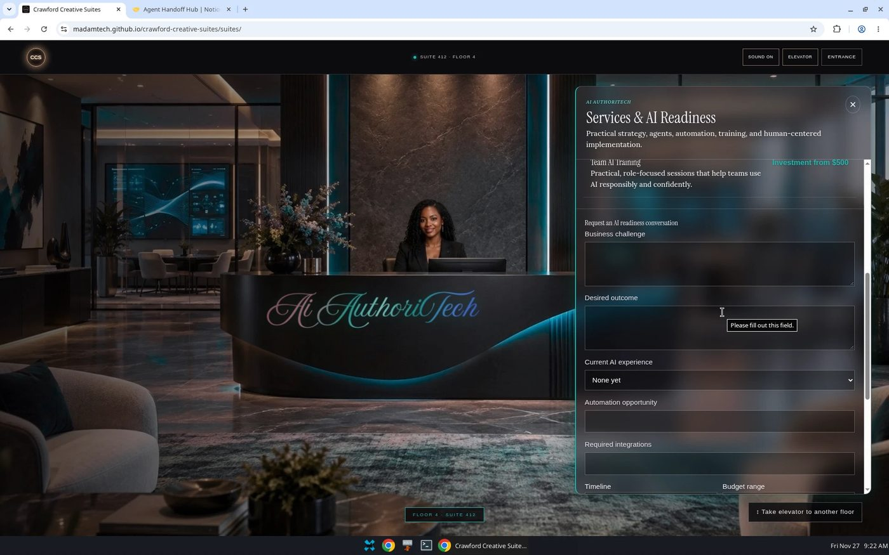
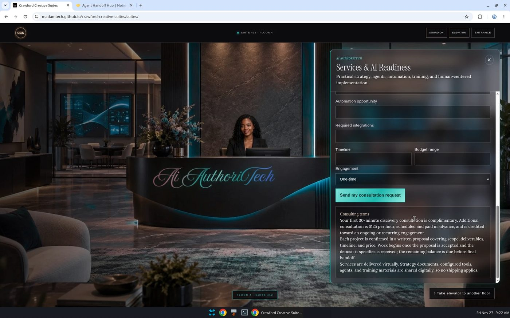
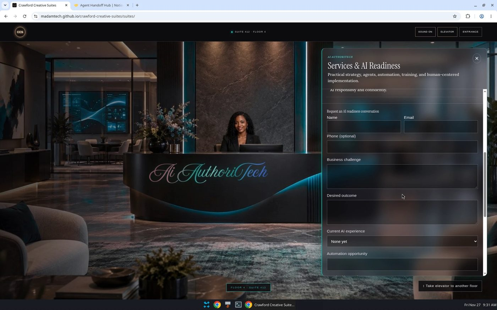
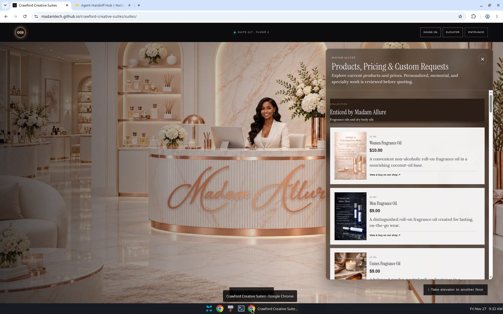
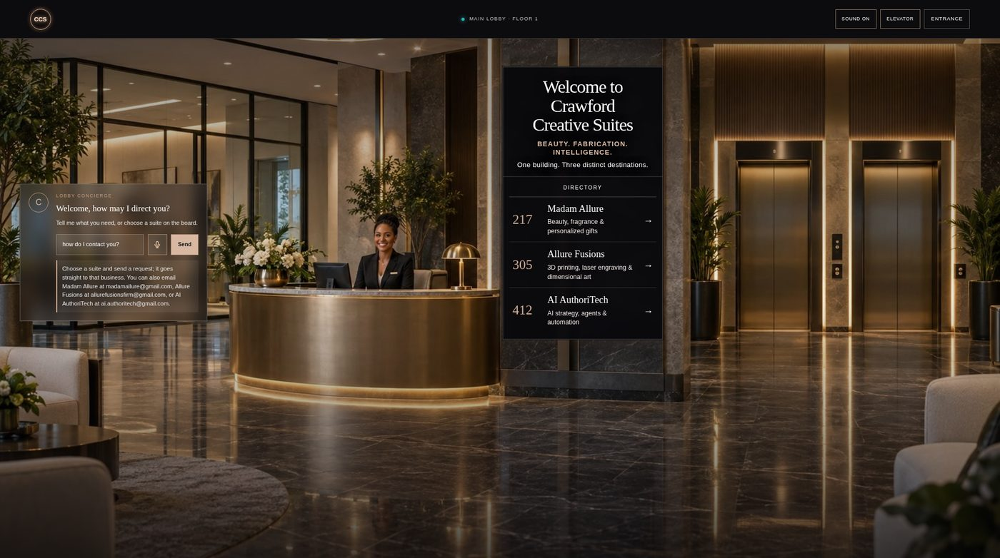

# Crawford Creative Suites — Admin Guide

This is the training record for changes to the public website at https://madamtech.github.io/crawford-creative-suites/. Write each change as a dated section, in plain language, and do not delete earlier entries.

This file was started on Friday, Nov 27, 2026 (America/Chicago) because no existing admin guide was found in this repository, in AIAuthoriTech-OS, in Notion, or in Google Drive.

## How Peyton takes training screenshots

For a site change, Peyton first captures the live pages as they are, then makes the change, waits for GitHub Pages to update, and captures the same spots again. That gives a before-and-after set for training. Screenshots are stored with the guide under `docs/admin-guide/img/`. Test names, email addresses, and form answers may appear in the after shots so the new fields and inboxes can be seen; those were test details only, and no email was actually sent.

---

## 1. Request forms and the Allure Fusions inbox — Friday, Nov 27, 2026

### Why this change was made

Visitors who sent an Allure Fusions project request were emailing allurefusions@gmail.com, which is not the Allure Fusions Firm inbox already in use (allurefusionsfirm@gmail.com). The project form and the AI consultation form also had no Name, Email, or Phone fields, so a request could arrive with no way to reply if the visitor’s email app did not open. A leftover source preview page was also reachable on the live site and still pointed at an old ChatGPT site.

### What was changed

1. Allure Fusions requests, the concierge contact answer, the README, and the publishing notes now use allurefusionsfirm@gmail.com.
2. The Allure Fusions “Build My Project” form and the AI AuthoriTech “Request an AI readiness conversation” form now start with required Name and Email fields, plus an optional Phone field. Those details are included in the email body and in the text copied to the clipboard.
3. Madam Allure shop products were left as they were: they still use “View & buy on our shop.” An “Ask about this item” fallback exists in the code only for a product with no shop URL, and none of the current catalog items use it, so no new Madam Allure request form was added.
4. The arrival-page source file `src/ccs-preview.html` is still required to build the home page, so it was not deleted. The old ChatGPT site link in that file was replaced with a link to the live building (`suites/`), and `robots.txt` now also names `/src/` as not a public page.

### How to rebuild and publish (for the next update)

1. On a computer signed in to the GitHub account `madamtech`, open the `crawford-creative-suites` folder.
2. Edit the source as needed. Business inboxes live in `build/send.js`. Form field inserts live in `build/patch.mjs`. The concierge’s spoken-and-written contact answer lives in `build/faq.js`.
3. Run `npm install` if dependencies are missing, then `npm run build`.
4. Preview locally with `node build/serve.mjs` or `npm run serve`, using http://127.0.0.1 (not localhost) as described in PUBLISHING.md.
5. Confirm a test Fusions request is addressed to allurefusionsfirm@gmail.com and that Name and Email appear in the email body and the copied text.
6. After the owner approves, commit, push to `main`, and wait about a minute for GitHub Pages to update.
7. Check the live building at https://madamtech.github.io/crawford-creative-suites/suites/ and confirm `https://madamtech.github.io/crawford-creative-suites/suites/app.js` contains allurefusionsfirm@gmail.com and does not contain the old allurefusions@gmail.com address.

### What we found on Madam Allure (Suite 217)

On the live site before this change, Suite 217 did not show any “Ask about this item” button. Shop products only showed “View & buy on our shop,” custom gift sets showed name, price, and details with no request button, and memorial items showed the text “Custom Quote” only. That matches the code: “Ask about this item” exists only as a fallback for a catalog product that has no shop URL, and every current shop product has a URL. No new Madam Allure request form was added to the gift sets or memorial items, because those screens did not already have one.

### Screenshots for training

Taken on the live site on Friday, Nov 27, 2026, America/Chicago, before and after this change. The images are compressed copies; the originals are also kept in the training-captures folder.

**Before, Floor 1 lobby**

The main lobby, before the inbox and form changes.

**Before, Allure Fusions project form**

The top of “Build My Project” before the change. It began with Service type. Name and Email were not on the form. The old allurefusions@gmail.com address was not shown on this page; it only appeared after submit, in the email itself.

The bottom of the same form, before the change.

**After, Allure Fusions project form**

The same form after the change, with Name, Email, and optional Phone at the top.

After a test submit, the “request is ready to send” notice shows allurefusionsfirm@gmail.com. This used test details only; no email was sent.

**Before, AI AuthoriTech readiness form**

The top of the readiness conversation form before the change, starting with Business challenge and no contact fields.

The bottom of the same form, before the change.

**After, AI AuthoriTech readiness form**

The readiness form after the change, with Name, Email, and optional Phone under the heading.

After a test submit, the notice is addressed to ai.authoritech@gmail.com, and the copied request includes the contact details. This used test details only; no email was sent.

**Before, Madam Allure products**

Madam Allure products before the change, showing “View & buy on our shop” rather than “Ask about this item.”

The lower part of the same catalog, including “Custom Quote” text where it appears.

**After, Madam Allure products**

Madam Allure products after the change. They still use “View & buy on our shop.” No new ask form was added.

**After, lobby concierge contact answer**

In the lobby, after asking “how do I contact you?”, the concierge lists allurefusionsfirm@gmail.com for Allure Fusions.
