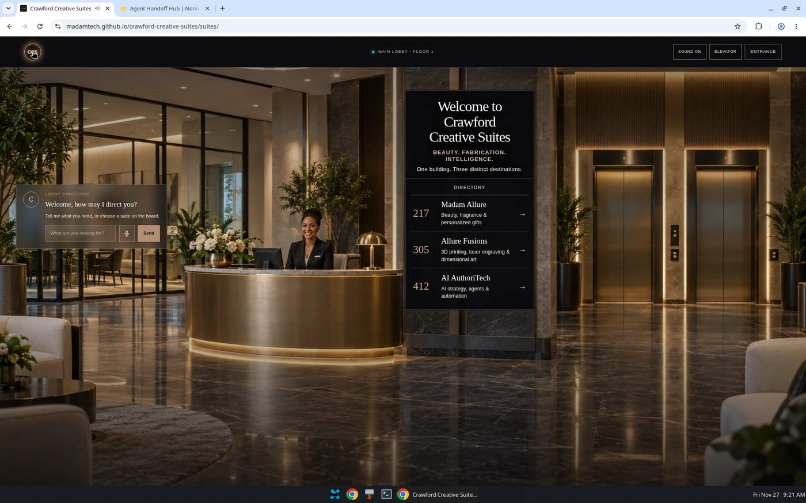
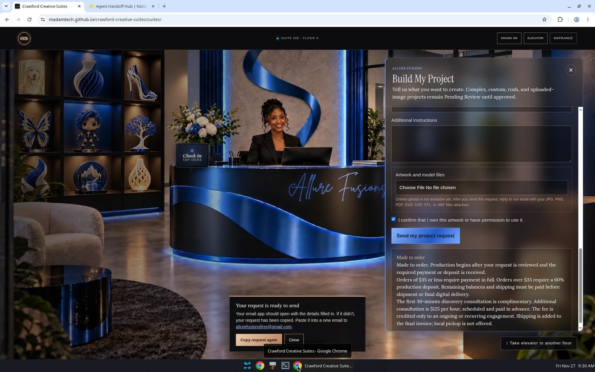
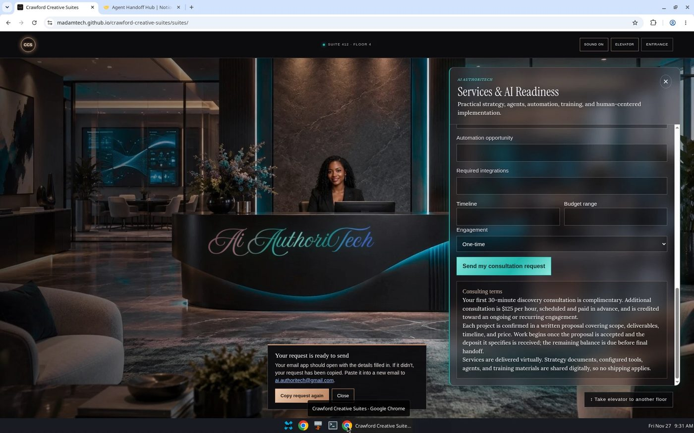
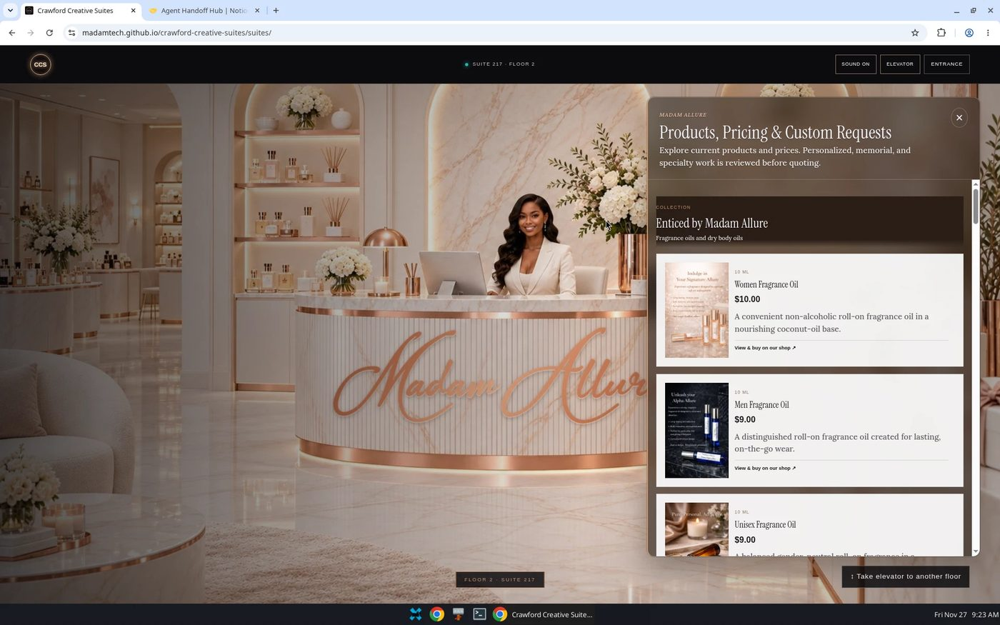
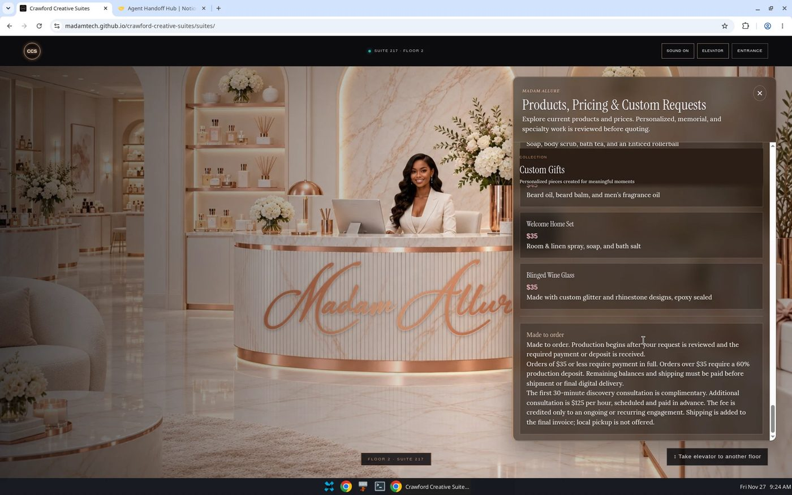
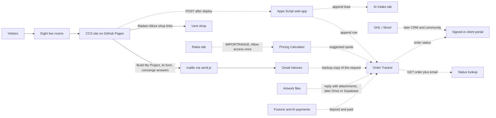

# Crawford Creative Suites — Admin Guide

This is the training record for changes to the public website at https://madamtech.github.io/crawford-creative-suites/. Write each change as a dated section, in plain language, and do not delete earlier entries.

This file was started on Friday, Nov 27, 2026 (America/Chicago) because no existing admin guide was found in this repository, in AIAuthoriTech-OS, in Notion, or in Google Drive.

## How Peyton takes training screenshots

For a site change, Peyton first captures the live pages as they are, then makes the change, waits for GitHub Pages to update, and captures the same spots again. That gives a before-and-after set for training. Screenshots are stored with the guide under `docs/admin-guide/img/`. Test names, email addresses, and form answers may appear in the after shots so the new fields and inboxes can be seen; those were test details only, and no email was actually sent.

---

## 1. Request forms and the Allure Fusions inbox — Friday, Nov 27, 2026

### Why this change was made

Visitors who sent an Allure Fusions project request were emailing allurefusions@gmail.com, which is not the Allure Fusions Firm inbox already in use (allurefusionsfirm@gmail.com). The project form and the AI consultation form also had no Name, Email, or Phone fields, so a request could arrive with no way to reply if the visitor’s email app did not open. A leftover source preview page was also reachable on the live site and still pointed at an old ChatGPT site.

### What was changed

1. Allure Fusions requests, the concierge contact answer, the README, and the publishing notes now use allurefusionsfirm@gmail.com.
2. The Allure Fusions “Build My Project” form and the AI AuthoriTech “Request an AI readiness conversation” form now start with required Name and Email fields, plus an optional Phone field. Those details are included in the email body and in the text copied to the clipboard.
3. Madam Allure shop products were left as they were: they still use “View & buy on our shop.” An “Ask about this item” fallback exists in the code only for a product with no shop URL, and none of the current catalog items use it, so no new Madam Allure request form was added.
4. The arrival-page source file `src/ccs-preview.html` is still required to build the home page, so it was not deleted. The old ChatGPT site link in that file was replaced with a link to the live building (`suites/`), and `robots.txt` now also names `/src/` as not a public page.

### How to rebuild and publish (for the next update)

1. On a computer signed in to the GitHub account `madamtech`, open the `crawford-creative-suites` folder.
2. Edit the source as needed. Business inboxes live in `build/send.js`. Form field inserts live in `build/patch.mjs`. The concierge’s spoken-and-written contact answer lives in `build/faq.js`.
3. Run `npm install` if dependencies are missing, then `npm run build`.
4. Preview locally with `node build/serve.mjs` or `npm run serve`, using http://127.0.0.1 (not localhost) as described in PUBLISHING.md.
5. Confirm a test Fusions request is addressed to allurefusionsfirm@gmail.com and that Name and Email appear in the email body and the copied text.
6. After the owner approves, commit, push to `main`, and wait about a minute for GitHub Pages to update.
7. Check the live building at https://madamtech.github.io/crawford-creative-suites/suites/ and confirm `https://madamtech.github.io/crawford-creative-suites/suites/app.js` contains allurefusionsfirm@gmail.com and does not contain the old allurefusions@gmail.com address.

### What we found on Madam Allure (Suite 217)

On the live site before this change, Suite 217 did not show any “Ask about this item” button. Shop products only showed “View & buy on our shop,” custom gift sets showed name, price, and details with no request button, and memorial items showed the text “Custom Quote” only. That matches the code: “Ask about this item” exists only as a fallback for a catalog product that has no shop URL, and every current shop product has a URL. No new Madam Allure request form was added to the gift sets or memorial items, because those screens did not already have one.

### Screenshots for training

Taken on the live site on Friday, Nov 27, 2026, America/Chicago, before and after this change. The images are compressed copies; the originals are also kept in the training-captures folder.

**Before, Floor 1 lobby**

The main lobby, before the inbox and form changes.

**Before, Allure Fusions project form**

The top of “Build My Project” before the change. It began with Service type. Name and Email were not on the form. The old allurefusions@gmail.com address was not shown on this page; it only appeared after submit, in the email itself.

The bottom of the same form, before the change.

**After, Allure Fusions project form**

The same form after the change, with Name, Email, and optional Phone at the top.

After a test submit, the “request is ready to send” notice shows allurefusionsfirm@gmail.com. This used test details only; no email was sent.

**Before, AI AuthoriTech readiness form**

The top of the readiness conversation form before the change, starting with Business challenge and no contact fields.

The bottom of the same form, before the change.

**After, AI AuthoriTech readiness form**

The readiness form after the change, with Name, Email, and optional Phone under the heading.

After a test submit, the notice is addressed to ai.authoritech@gmail.com, and the copied request includes the contact details. This used test details only; no email was sent.

**Before, Madam Allure products**

Madam Allure products before the change, showing “View & buy on our shop” rather than “Ask about this item.”

The lower part of the same catalog, including “Custom Quote” text where it appears.

**After, Madam Allure products**

Madam Allure products after the change. They still use “View & buy on our shop.” No new ask form was added.

**After, lobby concierge contact answer**

In the lobby, after asking “how do I contact you?”, the concierge lists allurefusionsfirm@gmail.com for Allure Fusions.

---

## 2. Order Tracker operator dashboard — Friday, Nov 27, 2026

### Why this change was made

The Allure Fusions Order Tracker was a starter sheet with one example row and no way to run the business from it. Website “Build My Project” requests still only opened an email. The next step was to make the Tracker a working operator dashboard, write the hook that can drop a request into the sheet without copying, and map how the eight live rooms can eventually sync both ways.

### What was already there

The Order Tracker, in the Allure Fusions Firm Drive folder `04 Orders & Production`, had one tab, a frozen green header, and these columns: Order #, Date, Client, Contact, Service (3D/Laser), Description, Material, Qty, Quote, Status, Due Date, Paid, Notes. Row AFF-0001 was an example (Service 3D, Paid No). There were no dropdowns, no formulas, no Dashboard, and no link to the Pricing Calculator.

The Pricing Calculator, in `06 Products & Pricing`, already had Labor and Price formulas and two example materials. That work was left in place.

### What was completed in the sheets

Existing data was not deleted. AFF-0001 and the calculator example costs are still there.

1. Added Email, Phone, Size, Source, Rush, Deposit, Balance, Suggested quote, Budget range, Shipping address, Project type, Details, and Last status change to the Order Tracker tab, so website form fields have a place to land.
2. Status dropdown: New Request, Pending Review, Quoted, Deposit Paid, In Production, Ready, Shipped, Completed, On Hold, Cancelled. Paid dropdown: No, Deposit, Paid in Full, Refunded. Service, Source, and Rush also have dropdowns. “3D” remains a valid Service value so the example row stays valid.
3. Balance is calculated (Quote minus Deposit, or $0 when Paid in Full). Suggested quote looks up the material on the Rates tab, which imports unit prices from the Pricing Calculator. The official Quote column stays blank until you type the price you are giving the customer.
4. Conditional formatting colors each status, marks Paid in Full, and highlights an overdue Due Date on an open order. The header row stays frozen, the first three columns stay frozen, and rows have alternating colors.
5. Added a Dashboard tab (first tab) with counts and money by status, open and overdue totals, collected and outstanding amounts, and a column chart of orders by status.
6. Added Rates (live price link), AI Intake (ready for AI AuthoriTech readiness requests), Updates (a log of Status and Paid changes, once the script is installed), and How to use.
7. On the Pricing Calculator, added a Lookup name column (PLA and Wood for the two example rows), currency and percent formats, and a short note. Example costs were not changed.

The first time you open the Rates tab, Sheets may show `#REF!`. Click **Allow access** so the Tracker can read the Pricing Calculator. That click has to be done in the browser while signed in as allurefusionsfirm@gmail.com.

Sheets: [Order Tracker](https://docs.google.com/spreadsheets/d/1KBRQgttCmPeZvLh9onxJubib6TDsZeHaLHJ-I4XEWQM/edit) and [Pricing Calculator](https://docs.google.com/spreadsheets/d/13XyH7fASkcMeD1tGisaMy514I0sy36g4rIm8Fa3M4qU/edit).

### Website hookup — written, not deployed yet

A Google Apps Script web app is ready. It can:

- Accept a POST from the site and append a Fusions order (next AFF-#### number) or an AI Intake row.
- Look up status when both the order number and the customer email are given (`?order=AFF-0002&email=…`). If they do not both match, it only says “Not found.”
- Log Status and Paid changes on the Updates tab. It never sends email.

The script is saved in this training folder on the box (`/workspace/training-captures/order-tracker/apps-script.gs`) and as a Google Doc in `04 Orders & Production`: [Order Tracker web app script](https://docs.google.com/document/d/158-mlrVx7FniWLS61k75zFVxkJVCRPaFd0o93nLPfsk/edit).

Peyton cannot deploy a Google Apps Script web app from the Drive connector, so the live site was not changed and the email fallback was left as it is. After the script is deployed in the browser (steps below), Peyton can add a POST from the Allure Fusions form and keep the current mailto copy as backup. Do not put a secret token in the public repo. Treat the web app URL like a password.

### How to deploy the web app (browser, signed in as allurefusionsfirm@gmail.com)

1. Open the [Order Tracker](https://docs.google.com/spreadsheets/d/1KBRQgttCmPeZvLh9onxJubib6TDsZeHaLHJ-I4XEWQM/edit).
2. Open **Extensions**, then **Apps Script**.
3. Delete the stub Code.gs content and paste the script from the Drive doc. Name the project “Order Tracker web app”.
4. Under **File** → **Project settings**, set the time zone to America/Chicago.
5. Open **Deploy** → **New deployment**. Type: **Web app**.
6. Description: CCS Order Tracker intake.
7. Execute as: **Me** (allurefusionsfirm@gmail.com).
8. Who has access: **Anyone**. The public site must be able to POST. Anyone with the URL can append a row, so keep the URL private until you are ready to put it on the site.
9. Authorize the script when Google asks.
10. Copy the web app URL (it ends with `/exec`).
11. Optional check: open the URL in a browser. You should see a short JSON reply that includes `ccs-order-tracker`.
12. Also open the Rates tab and click **Allow access** if you see `#REF!`.
13. Give the web app URL to Peyton so the site form can be wired, then rebuilt and pushed.

### How to use the tracker day to day

Open the Dashboard each day. Work the Order Tracker tab left to right: new requests first, type an official Quote, collect a deposit, move Status as the job moves, and mark Paid. Suggested quote is a starting point from the calculator; it will not overwrite your Quote. Ask customers to reply to the request email with artwork files until private upload is built, and store those files in Drive with the Order # in the name.

### Backend wiring

Solid lines are in place today. Dashed lines are the next connections.

**Already possible with what is built**

- The eight live rooms (arrival lobby, main lobby and concierge, Madam Allure and the Powder Room, Allure Fusions and the Maker’s Lounge, AI AuthoriTech and the Clarity Lounge) are a static site. There is no login and no database on the site.
- Allure Fusions and AI AuthoriTech forms collect Name, Email, and optional Phone, then copy the request and open mail to allurefusionsfirm@gmail.com or ai.authoritech@gmail.com. Madam Allure shop items go to Ueni. “Ask about this item” exists only when a product has no shop URL; current items do not use it. The concierge answers on the page and does not save a request.
- You can run the business from the Order Tracker by hand: type a row, set Status and Paid, use Suggested quote once Rates is authorized, and watch the Dashboard.
- File upload on the Fusions form is still disabled (a Supabase placeholder). No GHL, Skool, or Fusions/AI payment connection exists yet.

**What still needs to be added for requests, updates, and status to flow both ways**

1. Deploy the Apps Script web app (browser steps above), then wire the Fusions form to POST to it and keep the email fallback. After that, a project request can land in the Tracker with no copying.
2. Wire the AI readiness form to the same script so it lands on the AI Intake tab.
3. A simple status lookup on the site (order number plus email) can use the script’s GET, without a signed-in portal.
4. Optional later: when Status changes, draft or send an update email — this script does not send email on purpose.
5. Private file intake (Drive folder per Order #, or Supabase) so artwork is stored with the order instead of arriving only as an email attachment.
6. A signed-in client portal, later, so a customer can see their own status and files.
7. Hosted payments for Fusions deposits and AI retainers, writing Paid and Deposit back to the Tracker. Beauty checkout can stay on Ueni.
8. GHL and Skool, later, for CRM and community, not for taking the first Fusions order.

**Recommended order of operations**

1. In the browser, authorize Rates (Allow access) and deploy the Apps Script web app. Give Peyton the `/exec` URL.
2. Wire Build My Project to POST, keep mailto as backup, rebuild, and push. Confirm a test request creates the next AFF-#### row and still offers the email copy. Do not send a real customer email for the test.
3. Use the Tracker as the daily dashboard: quote, deposit, production, shipped.
4. Connect the AI form to AI Intake the same way.
5. Add a modest status-lookup page or message, then file intake, then payments, then a signed-in portal, then GHL/Skool.

Screenshots for this change should include the Dashboard, the Order Tracker tab with the new columns and AFF-0001 still present, the Rates tab after Allow access, How to use, and the Pricing Calculator Lookup name column. Before shots are the original single-tab starter sheet.
